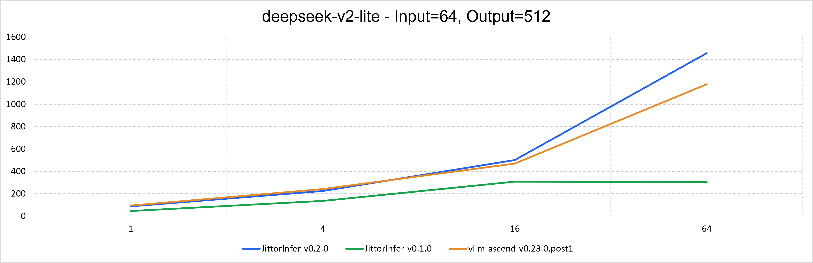
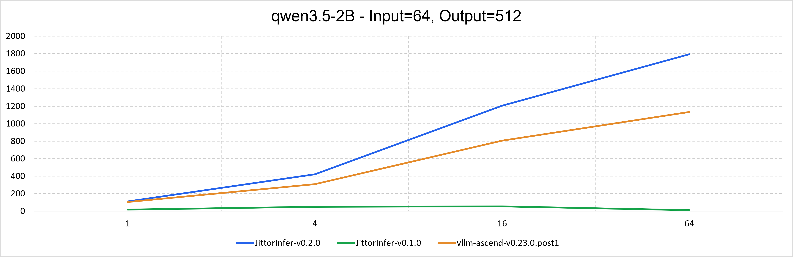
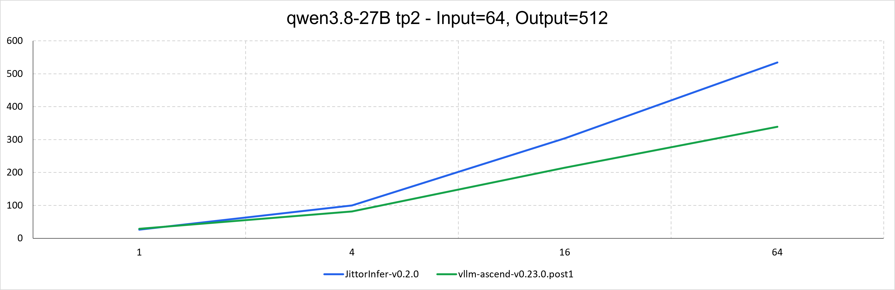
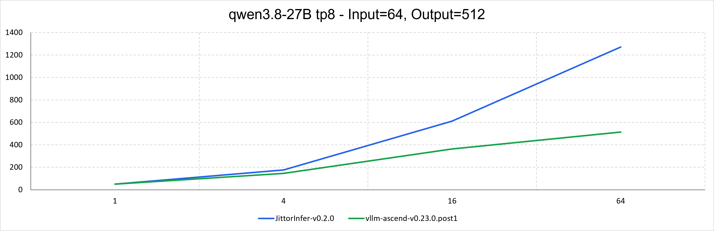
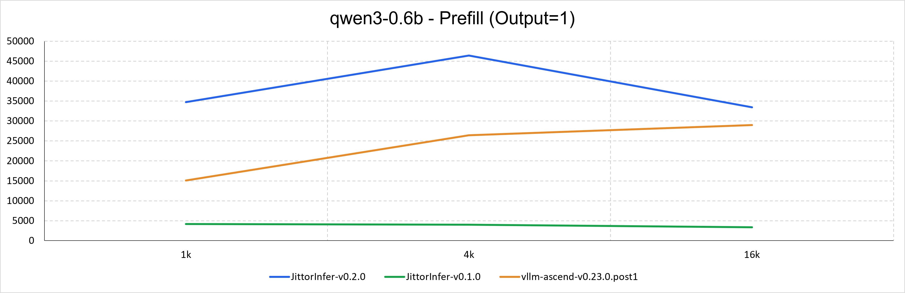
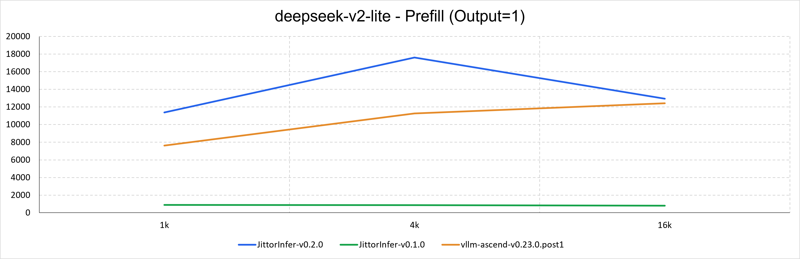

<div align="center">
  
</div>

# JittorInfer

**面向华为昇腾 NPU 的高性能 C++ 大模型推理框架。**

JittorInfer 为昇腾部署用户提供 OpenAI 兼容的推理服务，支持 **Qwen3.5 / Qwen3.8**、
Qwen3、Llama 和 DeepSeek-V2。v0.2.0 以 **Forch 计算图框架**为核心，结合
Rust 服务前端与 C++ 推理后端，在保留图执行与批处理能力的同时，让模型接入、
算子优化和服务部署各有清晰的扩展入口。

[快速开始](docs/quick-start.md) · [支持的模型](#支持的模型) · [架构](#架构) ·
[开发与文档](#开发与文档) · [交流与贡献](#交流与贡献)

## 最新动态

- **v0.2.0 发布**：重点支持 Qwen3.5 / Qwen3.8，采用 Forch 核心计算图框架，
  重构模型执行与服务架构，直接加载 Hugging Face safetensors 权重；支持 Qwen3 / Qwen3.5
  MoE 文本推理、Paged Attention 与前缀缓存复用，并提供 Docker 镜像与 LiteLLM Compose 部署。
- **2025.08.08**：JittorInfer v0.1.0 发布。

## 快速开始

- [环境准备与运行示例](docs/quick-start.md)：源码安装、模型准备、单卡与 TP 推理，以及旧版迁移。
- [Docker 部署](docs/docker.md)：预构建镜像的独立推理服务。
- [LiteLLM Compose](docker/litellm/README.md)：模型网关与管理页面。

## 核心能力

- **Qwen3.5 / Qwen3.8 混合注意力推理**：支持 Gated DeltaNet（GDN）线性注意力
  与 full attention 的混合结构，管理各层 KV cache、卷积历史与递归状态，支持融合
  Gated Delta Rule（GDR）算子。当前提供纯文本生成服务。
- **Qwen MoE 推理**：支持 Qwen3-30B-A3B、Qwen3.5-35B-A3B 等 MoE 文本模型，
  接入 BF16 专家权重、稀疏派发与 GroupedMatmul；Qwen3.5 同时支持带门控的共享专家。
  专家计算采用 TP 切分，各 rank 保留全部专家编号，不是 Expert Parallel（EP）。
- **昇腾图执行与融合优化**：以 C++ 构建模型计算图，由 CANN Graph Engine（GE）
  编译执行，接入融合 RoPE、Attention、MoE 等算子，并保留非融合参考路径用于调试。
- **连续批处理与分块预填充**：支持 continuous batching 与 chunked prefill，
  在同一步推进预填充和解码请求，按模型计算图的容量分配 token 预算。
- **Paged Attention 与前缀复用**：通过运行时块表读取分页 KV / MLA 缓存，
  从预分配页池中按需分配页面，减少逐请求预留最大上下文的容量浪费。
  支持适用文本模型的完整前缀块共享，以及页池不足时的请求抢占与重算。
- **单机多卡张量并行**：支持 Tensor Parallel（TP），通过 HMPI 启动多进程，
  由 HCCL 执行图内集合通信，切分注意力、前馈网络和词表输出层。
- **直接部署为 API 服务**：直接读取 Hugging Face 模型目录，无需转换为 GGUF；
  提供 OpenAI 兼容的聊天、文本补全与流式输出，可接入现有应用和客户端。
- **容器与网关部署**：提供包含 CANN、HMPI 和前后端二进制的 Docker 镜像；
  可选 LiteLLM + PostgreSQL Compose 部署，接入模型路由、管理页面和虚拟密钥。

## 支持的模型

| 模型 | 计算结构 |
| --- | --- |
| **Qwen3.5 / Qwen3.8** | Gated DeltaNet 线性注意力与 full attention 混合结构 |
| **Qwen3.5 MoE** | 混合注意力、路由专家与带门控的共享专家 |
| Qwen3 / Qwen3 MoE | Dense / MoE Transformer |
| Llama 2 / 3.x | Dense Transformer |
| DeepSeek-V2 / V2-Lite | Multi-head Latent Attention（MLA）与 MoE |

具体模型示例与精度要求见 [快速开始](docs/quick-start.md#模型配置示例)。

## 性能

**测试环境：** Atlas A2 / Ascend 910B3。使用仓库中的
[`bench-performance.sh`](script/benchmark/bench-performance.sh) 测速脚本，
使用方式见[评测工具指南](script/benchmark/README.md#性能测速)。

在相同硬件配置下，对比 JittorInfer v0.2.0、v0.1.0 与 vLLM-Ascend v0.23.0.post1
的吞吐表现。多卡测试采用张量并行（TP），未标注的测试默认为单卡 TP=1。

测试包含以下三个场景，吞吐单位均为 tokens/s：

| 场景 | 输入长度（tokens） | 输出上限（tokens） | 并发请求数 |
| --- | --- | --- | --- |
| Decode | 64 | 512 | 1 / 4 / 16 / 64 |
| Prefill | 1024 / 4096 / 16384 | 1 | 1 |

### Decode









### Prefill





## 整体架构

```text
OpenAI-compatible clients
             |
             v
Rust frontend: HTTP / tokenizer / chat templates
             |
       ZMQ + MessagePack
             |
             v
C++ backend: Transport -> Scheduler -> ModelRunner
                                          |
                           model runners + shared CacheRunner
                                          |
                           SlotMap / metadata / layer pools
                                          |
                                          v
                          Forch: C++20 tensors / ops / graphs
                                          |
                                          v
                              CANN GE / HCCL -> Ascend NPU
```

Rust 前端基于 [vLLM Rust 前端](https://github.com/vllm-project/vllm)，负责 HTTP、
分词、聊天模板和输出处理。JittorInfer 的 C++ 后端实现模型执行与请求调度，
使用兼容 vLLM engine-core 的通信协议，**不启动 vLLM Python 推理引擎**。
单卡为两个协作进程；TP 模式为一个 Rust 前端和多个 C++ 后端 rank。

### Forch：面向昇腾的核心计算图框架

forch 是 JittorInfer v0.2.0
的核心 C++20 张量与计算图框架。模型通过张量运算和神经网络模块描述计算，
由 Forch 将计算图映射到 CANN GE，再编译、加载并重复执行。

相较 v0.1.0 在 llama.cpp / ggml 上适配昇腾的方式，本次重点优化了
**模型表达、后端对接与扩展的组织方式**：

| 方面 | v0.1.0：ggml 适配 | v0.2.0：Forch 核心框架 |
| --- | --- | --- |
| 模型表达 | 在 llama 图构建与 ggml 后端中适配执行路径 | 使用 C++ 张量与模块接口组合模型，各模型 Runner 管理图与执行 |
| GE 对接 | 在 ggml CANN 后端维护逐算子与 GE 路径 | 由 Forch GE 后端统一处理算子映射、图编译和运行时资源，隔离 CANN ABI 细节 |
| 异构模型状态 | 扩展既有 llama 执行与缓存体系 | CacheRunner 统一执行与共享寻址，各层保留独立的 KV、MLA、GDN 数据池 |
| 权重加载 | 使用 GGUF 模型文件 | 直接加载 Hugging Face safetensors，通过内存映射读取权重 |

这种分层让模型接入不必改动公共调度逻辑，算子优化也可以在 Forch 中独立实现和验证。
例如 Qwen3.5 / 3.8 的 full attention 与 GDN 状态由同一个模型 Runner 协调，
不要求所有模型共享相同的缓存结构。Qwen3 和 Qwen3.5 各自的 dense / MoE 模型
共用家族 Runner，MoE 图复用对应 dense 模型的注意力、RoPE 和归一化模块，
专家权重和计算保留独立实现。各家族进一步通过公共 CacheRunner 复用图执行、
缓存预留与输入准备流程，调度器不需要理解物理页号。详细设计见 [后端架构](docs/architecture.md)。

## 开发与文档

| 入口 | 内容 |
| --- | --- |
| [backend/models/](backend/models/) | 模型配置、计算图与 Runner；在 [loader.hpp](backend/models/loader.hpp) 注册新模型 |
| [后端架构](docs/architecture.md) | Scheduler / ModelRunner / CacheRunner 分工、请求生命周期与模型扩展 |
| [KV cache 与 attention](docs/kv-cache.md) | 共享寻址、分页存储、前缀复用与算子方案 |
| [配置参考](docs/configuration.md) | 部署字段、默认值与约束 |
| [测试与验证](docs/testing.md) | 主机回归、NPU 数值检查与完整模型服务验证 |
| [Docker 使用](docs/docker.md) | 预构建镜像的单卡 / TP2 部署、设备挂载与接口验证 |
| [LiteLLM Compose](docker/litellm/README.md) | 网关、管理页面、模型路由、密钥和数据库持久化 |
| [HMPI](docs/hmpi.md) / [Tensor Parallel](docs/model-tp.md) | 多进程环境、设备选择与模型切分 |
| [通信协议](rust-frontend/ENGINE_PROTOCOL.md) | Rust 前端与 C++ 后端的 wire 格式 |
| [Forch](forch/) / [Rust 前端](rust-frontend/) | 核心计算图框架与服务前端子模块 |
| [评测工具](script/benchmark/README.md) | inference-benchmarker 性能测试与 OpenCompass 正确性评测 |

模型接入、算子优化和服务开发分别从模型目录、Forch 和 Rust 前端进入。
后端提供直接驱动 Runner 的模型调试入口，以及分页与前缀缓存、抢占重算、attention 和
TP 契约检查；NPU 测试覆盖数值参考与完整模型服务流程。验证方法见 [测试与验证](docs/testing.md)。

## 交流与贡献

欢迎通过 [Issues](https://github.com/Jittor/JittorInfer/issues) 反馈部署问题，
通过 [Pull Requests](https://github.com/Jittor/JittorInfer/pulls) 贡献模型适配、
算子优化、测试与文档。提交问题时请附上硬件型号、CANN 版本、模型与部署配置及相关日志。

感谢所有 [贡献者](https://github.com/Jittor/JittorInfer/graphs/contributors) 对项目的支持。
项目的发展借鉴和使用了 [llama.cpp](https://github.com/ggml-org/llama.cpp)、
[ggml](https://github.com/ggml-org/ggml)、[torchair](https://github.com/Ascend/torchair)、
[vLLM](https://github.com/vllm-project/vllm) 等开源项目的思想与代码。

## 许可证

JittorInfer 使用 [MIT License](LICENSE)。子模块及第三方依赖遵循各自的许可证，
模型权重遵循对应模型的许可条款。
