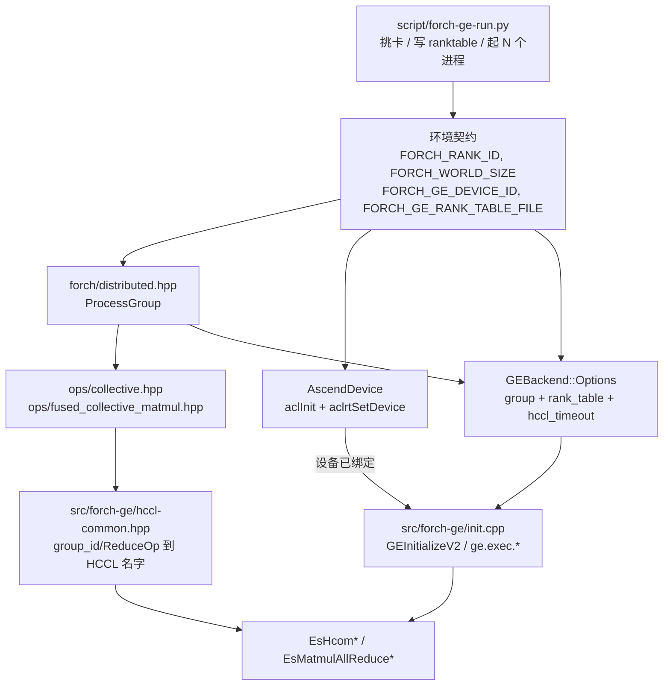

# 多卡通信层设计

给 reviewer 的架构说明。要改这类算子的具体步骤看
[forch-ge-operator skill](../.agents/skills/forch-ge-operator/references/collectives.md)，
这里只讲层次怎么分、为什么这么分。

## 要解决的问题

张量并行需要两类算子：纯集合通信（all_reduce 等六个原语）和 matmul 与通信融合成
一个节点的版本（通信能和计算重叠）。难点不在算子本身，而在**它们的依赖范围远超
一个算子**：每个进程要先绑定本地设备，再经 `GEInitializeV2` 向 HCOM 提供 rank 和通信拓扑。
到 `AddGraph` 时，通信配置已经确定。

所以这层横跨三个东西：后端无关的算子接口、GE 后端的进程级初始化、以及把两者喂起来
的多卡启动器。

## 分层



| 层 | 职责 | 不该知道的事 |
| --- | --- | --- |
| `forch/distributed.hpp` | 构造时合法的 `ProcessGroup`，含 rank、size、group id | 任何后端概念 |
| `ops/collective*.hpp` | `ReduceOp`、形状/dtype 规则、算子参数校验 | HCCL 组名、reduction 字符串、`ge.exec.*` |
| `src/forch-ge/hccl-common.hpp` | group id 和 reduction 到 HCCL 词汇的翻译 | 进程级配置状态 |
| `src/forch-ascend/device.cpp` | 绑定逻辑设备、分配显存和同步拷贝 | 全局 rank 和通信拓扑 |
| `src/forch-ge/init.cpp` | 拼 `GEInitializeV2` 选项 | 任何单个算子 |
| `script/forch-ge-run.py` | 挑卡、写 ranktable、导出环境变量、起进程 | 被启动的程序是什么 |

## 公共 API

`ProcessGroup` 是**纯参数对象**，不是进程级单例，调用方构造后逐次传入：

```cpp
forch::ProcessGroup group(0, 8); // rank_id, world_size, group_id 默认为 0

Tensor b = forch::op::all_reduce(a, group);                   // 默认 ReduceOp::Sum
Tensor c = forch::op::reduce_scatter(a, group, forch::op::ReduceOp::Max);
Tensor y = forch::op::fused_matmul_all_reduce(x1, x2, group);
```

六个原语沿用 `torch.distributed` 的名字；融合算子沿用上游
`torch.ops.symm_mem.fused_all_gather_matmul` / `fused_matmul_reduce_scatter`，
另外两个上游没有的按同样构词法补（`fused_matmul_all_reduce{,_add_rms_norm}`）。

`ProcessGroup` 构造时检查 `0 <= rank_id < world_size`，只读 accessor 保证之后仍然
合法，算子无需重复检查。算子的维度整除、root 越界等检查放在 `shape()`，在
`Tensor` 构造时执行；硬件 dtype 限制由 emitter 在 `backend.build()` 检查。

## 进程怎么起来

跑集合通信的进程必须先 `aclInit` + `aclrtSetDevice`，再带 ranktable 调
`GEInitializeV2`。设备初始化由 `AscendDevice` 负责，GE/HCCL 配置由 `GEBackend`
负责；调用方不需要直接调用 ACL 或 GE 的初始化接口。

1. launcher 给每个 rank 导出 `FORCH_RANK_ID` / `FORCH_WORLD_SIZE` / `FORCH_GROUP_ID`，
   并设置 `FORCH_GE_DEVICE_ID` / `FORCH_GE_RANK_TABLE_FILE`。它把各 rank 的
   `ASCEND_RT_VISIBLE_DEVICES` 收窄到对应的单张物理卡，所以进程内逻辑设备号恒为 0。
2. 构造 `AscendDevice::from_env()`，读取 `FORCH_GE_DEVICE_ID`，初始化 ACL 并绑定
   设备；也可以用 `AscendDevice(id)` 显式指定逻辑编号。
3. 将 Device 传给 `GEBackend(device)`，后者通过 `Options::from_env()` 读取 GE/HCCL
   配置；`GEBackend(device, options)` 使用显式配置，不自动合并环境变量。
4. Backend 使用调用方保持为当前的设备 context，由 `init.cpp` 拼出 `ge.exec.rankId` /
   `rankTableFile` / `deployMode` / `podName` / `hcclExecuteTimeOut`，交给
   `GEInitializeV2`。设备编号不再属于 `GEBackend::Options`。

相关环境变量如下，均应在进程启动前设置：

| 环境变量 | 默认值或 launcher 设置 | 含义 |
| --- | --- | --- |
| `FORCH_RANK_ID` | 默认 `0`；launcher 按所选卡列表从 0 编号 | 当前 rank，满足 `0 <= rank_id < world_size`。 |
| `FORCH_WORLD_SIZE` | 默认 `1`；launcher 设置为实际启动的 rank 数 | 进程数，必须大于等于 1；为 1 时跳过 HCOM 初始化配置。 |
| `FORCH_GROUP_ID` | 默认 `0`；launcher 固定为 `0` | 进程组标识。目前只创建默认 world group，非零值不会创建通信组。 |
| `FORCH_GE_DEVICE_ID` | 默认 `0`；launcher 固定为 `0` | 由 `AscendDevice::from_env()` 读取的逻辑设备号，即可见设备列表的下标。 |
| `FORCH_GE_RANK_TABLE_FILE` | 默认空；launcher 设置为生成或指定的文件绝对路径 | `world_size > 1` 时必须提供 rank table；表内设备编号是物理卡号。 |
| `FORCH_GE_HCCL_TIMEOUT` | 默认 `120`；launcher 继承父进程值 | HCCL 执行超时，单位为秒，必须大于 0。与 launcher 的 `--timeout` 进程运行期限不同。 |
| `FORCH_LOG_LEVEL` | 默认 `info`；launcher 继承父进程值 | Forch logger 的日志级别，例如 `debug`、`info`、`warning`、`error`、`off`；在 logger 首次创建时读取，不控制 Ascend Runtime 日志。 |
| `ASCEND_RT_VISIBLE_DEVICES` | launcher 为各 rank 设置为单张物理卡号 | Ascend Runtime 的可见设备列表。`--devices` 优先于父进程的该变量；两者都未指定时 launcher 报错。 |
| `ASCEND_WORK_PATH` | launcher 设置为本次运行目录下的 `ascend_work/` | Ascend 编译/运行工作文件目录，所有 rank 共用。launcher 会覆盖继承值，可通过 `--log-dir` 指定并保留运行目录。 |

Forch 的整数环境变量未设置或为空时使用默认值；非法整数、溢出和带空白的值会被
拒绝。`Options::from_env()` 读取时生成配置快照，后续修改环境变量不会更新已创建
的 options 或 Backend。`FORCH_GE_DEVICE_ID` 虽保留 `GE` 前缀，读取职责已移到 Device。

例如，已分配物理卡 2、3 后使用 `--devices 2,3`，rank 0 的
`ASCEND_RT_VISIBLE_DEVICES=2`，rank 1 的 `ASCEND_RT_VISIBLE_DEVICES=3`，两者的
`FORCH_GE_DEVICE_ID` 都是 `0`。不要把物理卡号直接当作收窄后的逻辑编号。
手动导出的 rank、world size、group id、设备号和 rank table 路径会被 launcher
覆盖；复用已有 rank table 应使用 `--rank-table` 参数。

直接运行单卡程序时，可显式设置 `ASCEND_WORK_PATH`。使用 `script/run-test.py`
时，该变量会被 `--work-path` 覆盖，默认是构建目录下的 `ascend_work`；runner 会
在调用 `srun` 前移除继承的 `ASCEND_RT_VISIBLE_DEVICES`，由 SLURM 分配卡，但不会
清除继承的 `FORCH_*` 分布式配置。

**一个进程只构造一个 `GEBackend`，通过复制句柄共享。** GE 的全局状态在初始化后
无法重新配置，所以第二次构造一律抛错，包括相同配置和析构后重建。复制的 Backend
句柄持有同一个 `shared_ptr<Impl>`。配置校验失败不会占用初始化机会；shim 只有一个
`forch_ge_init(options, count)` 入口，成功初始化后同样拒绝再次 init。
初始化和析构仍按单线程使用，不支持并发调用。

Backend 负责 session 和 GE 的销毁；Device 暂不调用 `aclFinalize` 或
`aclrtResetDevice`。`ge.exec.*` 初始化选项仍集中在 `init.cpp` 中，应用和测试只需
构造 Device、Backend，并通过 `process_group_from_env()` 获取算子使用的进程组。

## 几个不直观的决定

- **`ProcessGroup` 不做全局单例。** `group_id()` 是后端无关的整数，0 表示默认域。
  当前只创建默认 world group，没有子组或多 world 支持。非零 id 仅提供标识，不负责
  创建通信域。launcher 的 ranktable 用 `group_id: "0"` 记录 Forch 元数据，原生
  HCCL v1 表省略此项也表示同一个隐式 world group；它不是 CANN 的建组接口。
- **字符串全部下沉。** `"hccl_world_group"`、`"sum"` 这类值在公共头里出现，等于把
  后端词汇钉进 API。翻译放在 `hccl-common.hpp`，不再访问进程级配置快照或比较 group。
  调用方负责传入正确的通信域，launcher 在启动前校验 ranktable 的 rank/物理卡映射。
- **融合算子的 emitter 需要输入侧的 forch metadata。** `EsMatmulAllReduce` 有个
  `y_dtype` 属性必须显式填（留默认值 GE 会把 y 推成 `DT_FLOAT`，然后 tiling 报一个
  完全不提 `y_dtype` 的错）。而 `EsCTensorHolder` 只能写 dtype（`EsSetDataType`）
  不能读，所以 `GEOpRegistry` 的回调统一收一个 `GEOpContext`，里面除了 builder 和
  输入 holder 还带着它们背后的 `input_tensors`，emitter 用算子自己的
  `op->dtype(ctx.input_tensors)` 把类型算回来，而不是在 emitter 里重述一遍规则。
  单输出算子和扇出节点共用这一个上下文和同一种回调形状。
- **ranktable 只能是文件，且只能经 `GEInitializeV2`。** CANN 9.0.0 没有 inline
  ranktable 的 init key，传 `ge.exec.rankTable` 会在图编译期被拒（实测）。
- **物理卡号和逻辑卡号是两套。** ranktable 里的 `device_id` 必须是物理卡号，而
  `aclrtSetDevice` 收的是逻辑卡号（`ASCEND_RT_VISIBLE_DEVICES` 的下标）。launcher
  的做法是把每个 rank 收窄到一张卡，于是逻辑号恒为 0。
- **dtype 白名单属于后端，不属于算子。** "这块硬件能不能搬 FP64"不是 collective
  这个概念的性质，所以公共头里没有任何 `check_*_dtype`；白名单在
  各自的 `src/forch-ge/ops/collective.cpp` 和 `ops/fused_collective_matmul.cpp`，
  因此报在 `backend.build()` 而不是
  `Tensor` 构造时 —— 依然远早于 GE 编译。唯一真正属于算子的 dtype 规则是"各输入
  类型一致"，而基类 `Function::dtype()` 已经管了，不用重写。
- **dtype 以实测为准，不以 proto 为准。** `hcom_ops.h` 对 all_reduce 和
  reduce_scatter 都没写 BF16，但它们在 910B3 上跑得通、而且比 FP16 快，说明 GE 没有
  偷偷转 FP32。六个原语的 BF16 都实测过；融合算子只收 FP16/BF16，因为别的 dtype 需要
  这里没暴露的 antiquant/dequant-scale 输入。

## forch-ge 的文件划分

`GEBackend::Impl` 原来定义在 `graph.cpp` 里，导致所有碰它的代码都只能挤在那一个
TU（656 行，里面混着 GE 初始化、session 生命周期、设备内存搬运和执行路径）。现在
共同定义和函数声明放在私有的 `forch-ge-common.hpp`，不是 header-only 库；
函数实现按职责留在对应的 `.cpp` 中：

| 文件 | 内容 |
| --- | --- |
| `init.cpp` | 将通信配置转换为 `GEInitializeV2` 的进程级选项 |
| `backend.cpp` | `GEBackend` 外观、GE session、Runtime Tensor 定义/内存所有权/元数据、`move_to_device`、执行路径 |
| `graph.cpp` | 建图：`GEGraphBuilder` visitor、`AddGraph` 选项、`GEGraph` 句柄 |
| `forch-ge-common.hpp` | Graph/Backend 共同定义、GE 工具函数声明 |
| `common.cpp` | dtype 映射表、双向类型转换、shim 错误处理 |
| `op-registry.hpp` | `GEOpContext`、单/多输出算子注册和 dispatch |
| `hccl-common.hpp` | 通信词汇的 inline 翻译 |
| `src/utils.hpp` | 不安装的内部工具，如严格、检测溢出的 `getenv_int` |

设备句柄及其显存的所有权见 [Device 与设备内存的生命周期](device.md)。

## 怎么跑

最小可运行例子见 [example/ge-collective.cpp](../example/ge-collective.cpp)：每个
rank 输入 `rank_id + 1`，调用一次 `all_reduce`；两卡时都得到 `3`。文件开头写有
运行命令，目标名为 `forch-example-ge-collective`。

`script/forch-ge-run.py` 是通用多卡启动器，不是测试 runner —— `--` 之后原样透传，
所以起测试和起 TP 推理是同一条路径：

```bash
python script/forch-ge-run.py --devices 2,3 -- \
  ./build/src/forch-ge/tests/multirank/forch-ge-mr-collectives --dtype bf16

python script/forch-ge-run.py --devices 0,2,3,5 -- \
  ./build/backend/engine_server config.json
```

不与 SLURM 耦合：SLURM 分配卡并设好 `ASCEND_RT_VISIBLE_DEVICES`，那就是默认卡单，
但不经 `srun` 起进程。launcher 监视所有 rank，任意 rank 失败即终止其余进程组；
部分启动失败、超时和信号也会回收已启动的子进程。

两个测试的分工值得注意，缺一个都不够：

- `collectives.cpp` —— 每个算子对一份 host 参考值，参考值由"每个 rank 贡献了什么"
  算出来。
- `tp_align.cpp` —— 把**切分版**和**复制版**两条分支放进同一张图逐元素比。这才是
  能抓到"装配错了"的那个测试：shard 偏移差一、该 all_gather 用了 all_reduce、融合
  算子的 y 取在 residual 之前。host 参考值抓不到这类错误，因为它和切分版做的是同一
  个假设。输入取 0/1 且 K ≤ 256，所有中间和在任意求和顺序下都是精确整数，于是比较
  是 bit-exact 的，不需要调容差。

## 当前边界

- 只有默认 world group（id 0），没有子组或多 world 创建接口。
- 融合算子只支持 FP16/BF16，且 `fused_all_gather_matmul` 的 K 轴需要 ≥ 256。
- 融合算子只暴露一个输出。proto 的第二个输出（`norm_out` / `gather_out`）会让 matmul
  跑两遍，需要时在前端重算即可。
- 单进程（`world_size == 1`）下两个测试会干净地跳过，而不是失败。
- MC2 融合用例仅在 `{2,4,8}` 卡运行，其他卡数跳过；普通 collective 不套用此限制。
- host contract 测试覆盖 group 构造、环境整数溢出和全部 FP16 编码；启动器的
  无设备回归测试使用 `python script/test-forch-ge-run.py -v`。后者只验证启动器的
  环境传递、输入校验和失败回收，不是推理运行依赖，也不占用 NPU。
